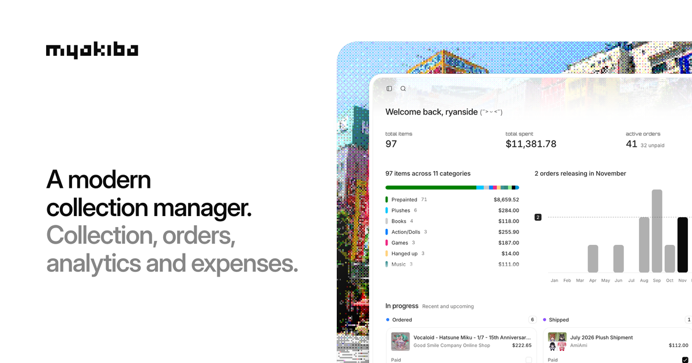
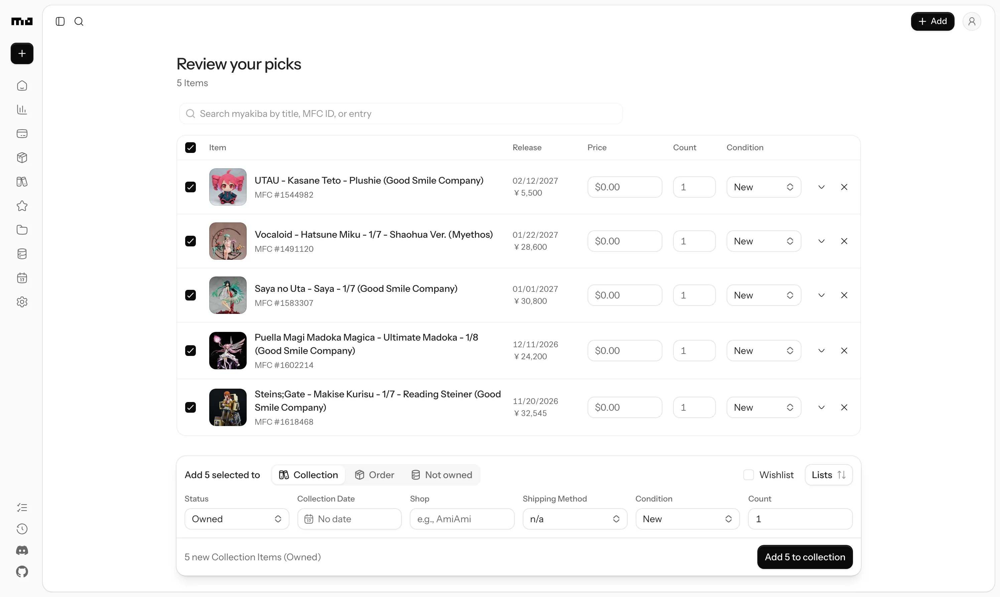
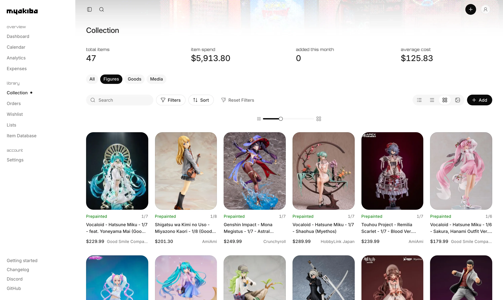
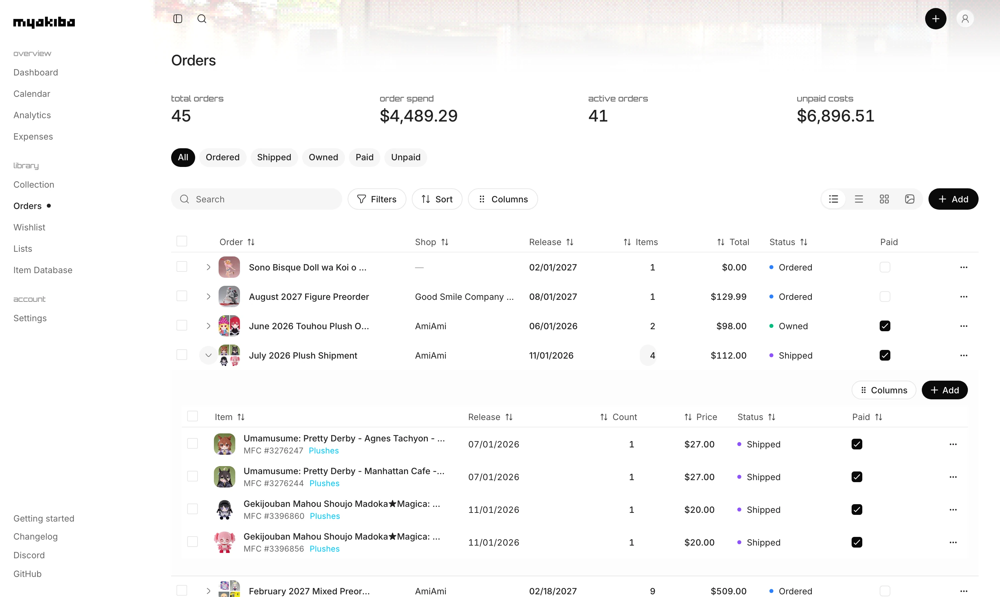
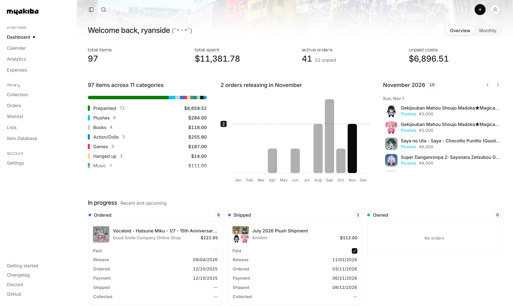
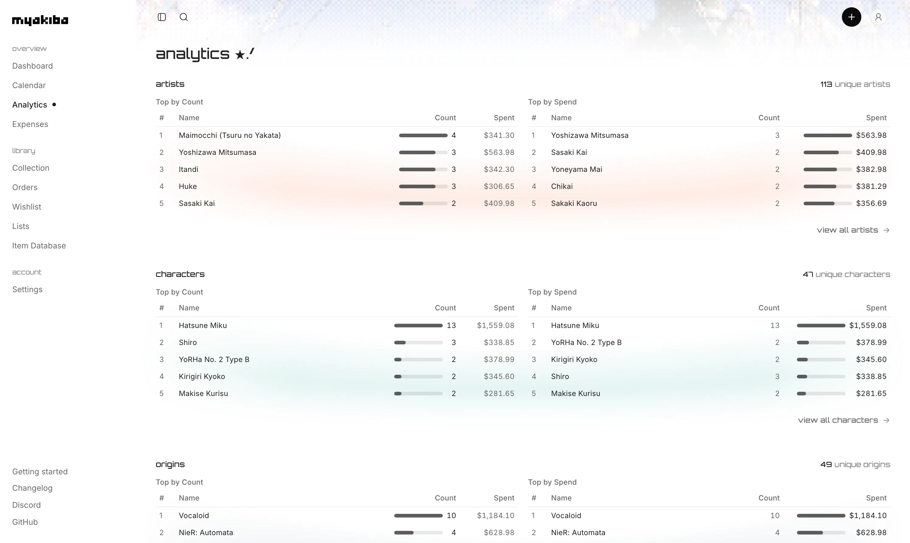

<div align="center">

  <h1>myakiba</h1>

  <a href="https://discord.gg/VKHVvhcC2z">
    
  </a>
  

</div>

myakiba tracks your collection of figures and other Japanese pop-culture goods, along with your orders, lists, wishlist, and spending. Its browser extension reads item details from MyFigureCollection, so you never type them.

Open the web app at [myakiba.app](https://myakiba.app). Install the browser extension from the [Chrome Web Store](https://chromewebstore.google.com/detail/myakiba/cipiinpifbjbpjnhghkeonigecihoebm) or [Firefox Add-ons](https://addons.mozilla.org/addon/myakiba/).

## Inside the app

### Add

On a MyFigureCollection item page, click **Pick for myakiba**. Each pick becomes a row on the Add page with its details filled in. Send your rows to your collection, a new or existing order, your wishlist, or your lists in one click.

https://github.com/user-attachments/assets/7b902fd9-fafe-4764-aecc-a6eb026b95cf



### Collection

View your collection as a table, a card grid, or an image gallery. Filter and sort your collection, choose columns, and move, resize, or pin them. Edit prices, scores, counts, releases, shops, and dates in the table.



### Orders

An order can hold several items, each with its own price, plus shipping, taxes, duties, tariffs, and miscellaneous fees. Track each order as Ordered, Shipped, or Owned, and mark it Paid or Unpaid. The Orders page has the same views, filters, and column controls as the Collection page.



### Dashboard

The dashboard shows your total items, total spend, active orders, and unpaid costs. It includes a collection breakdown, orders by release month, and a release calendar. Switch to the monthly view for one month's order totals, fees, shop breakdown, and order board.



### Analytics

See your artists, characters, origins, companies, classifications, events, materials, shops, and scales ranked by item count and by spend. Open any section for a searchable table and the collection items behind each result.



### Other pages

myakiba also includes these pages:

- **Expenses.** Break down spend and unpaid costs by date, shop, item prices, order fees, and shipping method.
- **Calendar.** See upcoming releases and orders by month.
- **Wishlist.** Keep a ranked set of items you plan to get.
- **Lists.** Group items, collection items, and orders into your own lists.

## Development and self-hosting

Read [`SETUP.md`](SETUP.md) to run myakiba locally or self-host it. The guide covers three setups:

- [Local development](SETUP.md#local-development) with `bun dev`.
- [The production build with Docker Compose](SETUP.md#production-build-with-docker-compose).
- [The browser extension against a local instance](SETUP.md#run-the-extension-against-a-local-instance) for Chrome and Firefox.

## Project structure

```
myakiba/
├── apps/
│   ├── web/         # Web app: React, Vite, TanStack Router, Tailwind CSS, shadcn/ui
│   ├── server/      # API and production web server: Elysia on Bun
│   └── extension/   # Browser extension for Chrome and Firefox: WXT
├── packages/
│   ├── auth/        # Better Auth configuration
│   ├── config/      # Shared TypeScript configuration
│   ├── contracts/   # Zod schemas, constants, and types shared by server, web, and extension
│   ├── db/          # Drizzle schema and PostgreSQL database scripts
│   ├── env/         # Typed environment schemas
│   ├── mfc/         # Parser for MyFigureCollection item pages
│   ├── redis/       # Redis client
│   └── utils/       # Shared utilities
├── AGENTS.md        # Rules for changing the code, and the check behind each rule
├── GLOSSARY.md      # What Item, Collection Item, Order, and the other domain words mean
└── SETUP.md         # Local development, browser extension, and Docker Compose setup
```

Turborepo runs the workspace tasks in [`turbo.json`](turbo.json).

## Contributing

Run these checks from the repository root before you push:

- `bun run check` checks formatting and lint.
- `bunx turbo run check-types` type-checks every package.
- `bun run test` runs every test and requires `TEST_DATABASE_URL` and `TEST_REDIS_URL`. `bun run test web` runs only the web app's tests and needs neither variable.
- `bun run knip` checks for undeclared dependencies and dead code.

CI runs the same checks. Read [`AGENTS.md`](AGENTS.md) for the full repository rules. Open issues, discussions, and pull requests on [GitHub](https://github.com/ryanside/myakiba).

[](https://github.com/ryanside/myakiba/graphs/contributors)

## License

myakiba is licensed under the [GNU Affero General Public License v3.0](LICENSE).
